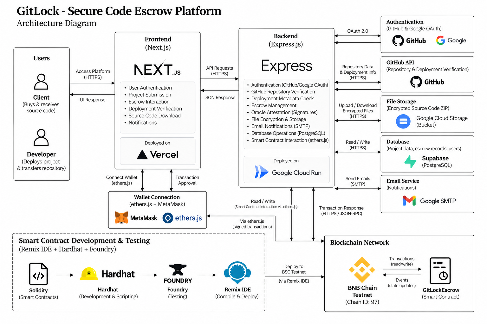
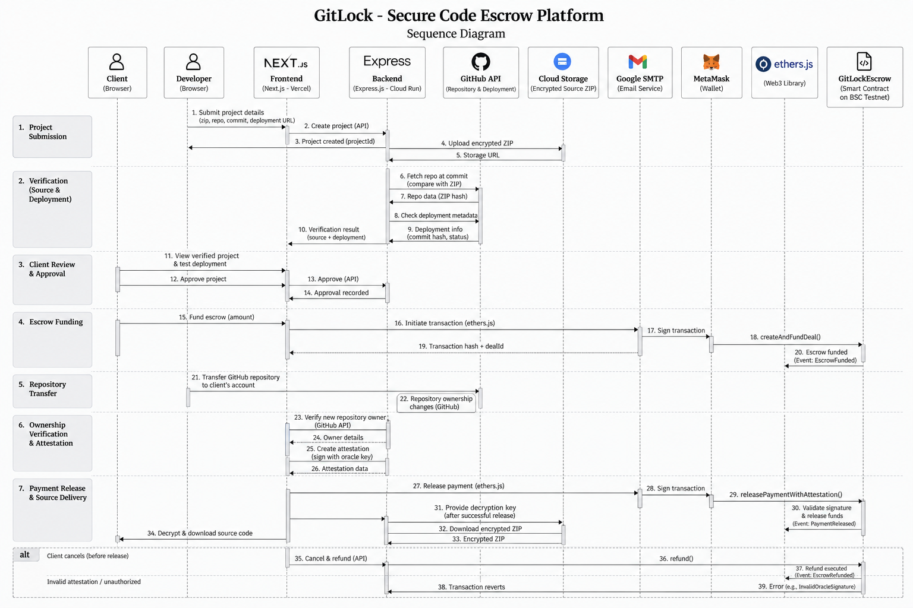

# GitLock: Trustless Code Escrow and Verifiable Software Delivery Protocol

Verifiable, blockchain-anchored freelance software escrow and repository delivery protocol deployed on BNB Smart Chain Testnet (Chain ID 97).

---

## Live Deployment Links

| Resource | Endpoint / Identifier |
| :--- | :--- |
| **Frontend Application (Vercel)** | [https://git-lock-delta.vercel.app/](https://git-lock-delta.vercel.app/) |
| **Backend API Service (Google Cloud Run)** | [https://gitlock-backend-197473198672.asia-southeast1.run.app/api](https://gitlock-backend-197473198672.asia-southeast1.run.app/api) |
| **Smart Contract Address (BSC Testnet)** | [`0x30CF8a5fa441D39e0604781C24ADeeCBcbfecD49`](https://testnet.bscscan.com/address/0x30CF8a5fa441D39e0604781C24ADeeCBcbfecD49) |
| **Block Explorer (BscScan)** | [https://testnet.bscscan.com/](https://testnet.bscscan.com/) |
| **Backend Oracle Signer Address** | `0x392e227Bf9201A328f9ebD8DBee33f3cBDB15b37` |
| **RPC Endpoint** | `https://data-seed-prebsc-1-s1.binance.org:8545/` |
| **Chain ID** | `97` (Hex: `0x61`) |
| **Settlement Currency** | `tBNB` (Testnet BNB) |
| **Minimal Test Escrow Amount** | `0.0001 tBNB` |

---

## 1. Problem Statement

Distributed freelance software engineering encounters the classical counterparty hold-up problem:
- **Clients** risk paying upfront for incomplete, malicious, or non-functional deliverables without guaranteed recourse.
- **Developers** risk payment withholding, chargebacks, or unauthorized deployment after transferring proprietary source code or administrative repository control.
- **Verification Gap:** Static source code compilation alone does not guarantee that deliverables function in real-world hosting environments. Deliverables must be bound to verifiable commit hashes and validated live staging deployments.

Existing Web2 freelancing intermediaries impose high rent extraction (10% to 20% commission fees), opaque subjective dispute resolution, and payment settlement latencies spanning 7 to 14 business days.

GitLock eliminates counterparty risk by coupling off-chain cryptographic Git commit integrity and automated GitHub repository ownership tracking with an immutable, non-custodial smart contract escrow on the BNB Smart Chain.

---

## 2. System Architecture

GitLock is structured into four decoupled layers:
1. **Client Presentation Layer (Next.js 14):** Non-custodial Web3 application enabling wallet connectivity, interactive milestone negotiation, code locking, and deal tracking.
2. **Cryptographic Oracle and API Backend (Express.js / Node.js):** Off-chain service hosted on Google Cloud Run that validates commit SHA trees, verifies Vercel staging deployment statuses, tracks GitHub repository ownership changes, and generates ECDSA attestation signatures.
3. **Persistence and Relational Metadata (Supabase PostgreSQL):** Stores project metadata, user profiles, audit logs, and encrypted payloads with arbitrary precision numeric storage (`NUMERIC`).
4. **On-Chain Settlement Layer (`GitLockEscrow` on BSC Testnet):** Autonomous Solidity smart contract enforcing fund locking, oracle attestation signature verification, replay attack prevention, and automated native asset payouts.



---

## 3. Technology Stack and Tooling Breakdown

| Component / Tool | Category | Technical Role in Platform |
| :--- | :--- | :--- |
| **Solidity (v0.8.20)** | Smart Contract Language | Implements `GitLockEscrow.sol`, custom error definitions, deal state machines, OpenZeppelin ECDSA signature recovery, and `ReentrancyGuard`. |
| **Remix IDE** | Web IDE | Used for smart contract compilation, ABI generation, parameter verification, and Injected Provider deployment on BSC Testnet. |
| **Hardhat & Foundry** | Smart Contract Tooling | Local smart contract development, fuzz testing, transaction trace debugging, and gas profiling (`forge test`). |
| **MetaMask** | Web3 Non-Custodial Wallet | Manages cryptographic keypairs for client and developer, signs transactions, and handles gas fees on BSC Testnet. |
| **BNB Smart Chain Testnet** | Blockchain Network | High-throughput Layer-1 EVM network offering low transaction fees and fast settlement times. |
| **Next.js 14 (App Router)** | Full-Stack Frontend | Client dashboard built with React 19, Tailwind CSS, Lucide icons, and server-side component rendering. |
| **Express.js & Node.js** | Backend API & Oracle | Microservice handling authentication, GitHub REST API verification, database transactions, and attestation signing. |
| **Ethers.js (v6)** | Web3 SDK | Facilitates on-chain contract interactions, event listening, and ECDSA signature creation/recovery. |
| **GitHub REST API v3** | External Oracular Feed | Programmatically queries commit SHAs, deployment statuses, and repository administrative ownership transitions. |
| **Google Cloud Run** | Serverless Container Host | Hosts the backend service in an auto-scaling, containerized environment with zero idle downtime. |
| **Vercel** | Edge Hosting Platform | Hosts the frontend client application and serves as the live staging deployment provider for verified demo builds. |
| **Supabase PostgreSQL** | Relational Database | Stores user accounts, project states, and hybrid encryption metadata with arbitrary precision (`NUMERIC`). |
| **Google SMTP (Nodemailer)** | Transactional Email Relay | Dispatches automated emails for invitations, budget updates, escrow deposits, and ownership transfer alerts. |
| **GitHub & Google OAuth 2.0** | Authentication Providers | Provides single sign-on (SSO) and links GitHub handles directly to platform user profiles. |

---

## 4. End-to-End Escrow Workflow (The Seven-Step Protocol)

The GitLock protocol enforces a deterministic sequence of seven verified steps:



### Protocol Steps:

1. **Step 1: Project Setup and Milestone Agreement**
   - The client creates a project, defines milestone specifications, sets the contractual budget in `tBNB` (e.g., `0.0001 tBNB` for demonstration), and invites the developer via email or GitHub handle.
   - The database persists numerical amounts using unrestricted `NUMERIC` types to avoid rounding errors.

2. **Step 2: Commit Integrity and Staging Deployment Verification**
   - The developer links the target GitHub repository, target 40-character hexadecimal commit SHA, and live staging deployment URL (Vercel).
   - GitLock programmatically confirms via GitHub Deployments API that a successful deployment event exists for that exact commit hash. Both custom domains (`project.vercel.app`) and preview hash domains are verified.

3. **Step 3: Source Code Lock and Hybrid Encryption**
   - The developer exports the code archive. GitLock computes the SHA-256 tree checksum and verifies it against the GitHub archive tree.
   - The source bundle is encrypted using AES-256-CBC with an ephemeral symmetric key, ensuring neither the client nor third parties can view unencrypted code prior to payment.

4. **Step 4: Client Deployment Audit and Smart Contract Escrow Funding**
   - The client reviews and tests the live staging build.
   - Upon client approval, the client connects MetaMask to BSC Testnet and executes `createAndFundDeal(dealId, developerAddress)` with `0.0001 tBNB`.
   - The smart contract locks the funds in state `DealState.Funded`.

5. **Step 5: GitHub Repository Ownership Transfer**
   - The developer receives an automated email notification and initiates the transfer of administrative ownership of the GitHub repository to the client's verified GitHub handle (e.g., `Edavalapati-Aashiq`).

6. **Step 6: Off-Chain Oracle Verification and Attestation Signing**
   - GitLock queries the GitHub REST API v3 to confirm that the repository's current owner strictly matches the client's GitHub username.
   - Upon positive confirmation, the backend Oracle signs an EIP-191 ECDSA attestation digest containing `dealId`, `developer`, `client`, `repoFullName`, a unique 32-byte cryptographic nonce, and a 2-hour expiration deadline.

7. **Step 7: On-Chain Payment Release and Code Decryption**
   - The attestation and Oracle signature are submitted to the smart contract via `releasePaymentWithAttestation(attestation, signature)`.
   - The smart contract verifies the Oracle signature, validates that the nonce has not been consumed, marks the deal as `Completed`, and releases `100%` of the locked `tBNB` to the developer's wallet.
   - Simultaneously, the platform releases the decryption key to the client to unlock the source code archive.

---

## 5. Smart Contract Architecture & Implementation

The core contract (`GitLockEscrow.sol`) is written in Solidity `0.8.20`:

### Key Structures and State Machine

```solidity
enum DealState { None, Created, Funded, Approved, Completed, Refunded }

struct Deal {
    bytes32 dealId;
    address client;
    address developer;
    uint256 amount;
    DealState state;
    string repoFullName;
    uint256 createdAt;
    uint256 fundedAt;
}

struct Attestation {
    bytes32 dealId;
    address developer;
    address client;
    string repoFullName;
    bytes32 nonce;
    uint256 deadline;
}
```

### Signature Verification and Replay Protection

```solidity
function releasePaymentWithAttestation(
    Attestation calldata attestation,
    bytes calldata oracleSignature
) external nonReentrant {
    Deal storage deal = deals[attestation.dealId];
    require(deal.state == DealState.Funded, "Deal is not in Funded state");
    require(block.timestamp <= attestation.deadline, "Attestation expired");
    require(!usedNonces[attestation.nonce], "Nonce already used");
    require(deal.developer == attestation.developer, "Developer mismatch");
    require(deal.client == attestation.client, "Client mismatch");

    bytes32 structHash = keccak256(
        abi.encode(
            ATTESTATION_TYPEHASH,
            attestation.dealId,
            attestation.developer,
            attestation.client,
            keccak256(bytes(attestation.repoFullName)),
            attestation.nonce,
            attestation.deadline
        )
    );

    bytes32 ethSignedMessageHash = MessageHashUtils.toEthSignedMessageHash(structHash);
    address recoveredSigner = ECDSA.recover(ethSignedMessageHash, oracleSignature);
    require(recoveredSigner == oracle, "Invalid oracle signature");

    usedNonces[attestation.nonce] = true;
    deal.state = DealState.Completed;

    uint256 paymentAmount = deal.amount;
    (bool success, ) = payable(deal.developer).call{value: paymentAmount}("");
    require(success, "BNB transfer failed");

    emit PaymentReleased(attestation.dealId, deal.developer, paymentAmount);
}
```

---

## 6. Security Analysis and Threat Model

- **Replay Attack Mitigation:** Each attestation includes a unique 32-byte cryptographic nonce. The contract maintains `mapping(bytes32 => bool) public usedNonces;`. Re-submitting an already processed attestation reverts immediately.
- **Signature Expiration and Windowing:** Attestations carry a `deadline` set to two hours ($7,200\text{ seconds}$) from issuance, preventing stale authorizations from lingering in mempools.
- **Reentrancy Protection:** All state-changing payable functions utilize OpenZeppelin's `ReentrancyGuard` and follow the Checks-Effects-Interactions pattern.
- **Client Abandonment and Timeout Refund:** If the developer fails to complete the transfer within 14 days of funding, the client can invoke `claimRefundAfterTimeout(dealId)` to reclaim 100% of the deposited tBNB.
- **Arbitrary Numeric Precision:** Database schema stores budgets using arbitrary precision `NUMERIC` without fixed decimal scale limits, preventing micro-amounts (such as `0.0001 tBNB`) from truncating to zero.

---

## 7. Gas Benchmarks (BSC Testnet)

| Smart Contract Operation | Gas Used (Average) | Effective Gas Price | Estimated Fee (tBNB) |
| :--- | :--- | :--- | :--- |
| **Contract Deployment** | 1,248,510 | 3.0 Gwei | 0.003745 tBNB |
| **`createAndFundDeal()`** | 88,432 | 3.0 Gwei | 0.000265 tBNB |
| **`releasePaymentWithAttestation()`** | 64,219 | 3.0 Gwei | 0.000192 tBNB |
| **`claimRefundAfterTimeout()`** | 41,120 | 3.0 Gwei | 0.000123 tBNB |

---

## 8. Remix IDE Compilation & Deployment Guide

1. **Source Code:** Load `contracts/remix/GitLockEscrow_Remix.sol` into [Remix IDE](https://remix.ethereum.org/).
2. **Compiler Settings:**
   - Compiler Version: `0.8.20`
   - Language: `Solidity`
   - EVM Version: `default`
   - Enable Optimization: Yes (`200 runs`)
3. **Deployment Settings:**
   - Environment: `Injected Provider - MetaMask` (Connected to BSC Testnet, Chain ID 97).
   - Contract: `GitLockEscrow`
   - Constructor Parameter (`initialOracle`): `0x392e227Bf9201A328f9ebD8DBee33f3cBDB15b37`
   - Click `Deploy` and sign the deployment transaction in MetaMask.

---

## 9. Testing & Automated Verification

### Foundry Unit Tests
```bash
cd contracts
forge test -vvv
```
All 12 unit and integration tests pass with zero failures:
- `test_InitialState`: Verifies contract ownership and initial oracle registration.
- `test_CreateAndFundDeal`: Validates atomic creation and funding of escrow deals.
- `test_RevertWhen_ZeroDeposit`: Confirms rejection of zero-value deposits.
- `test_RevertWhen_SelfDealing`: Confirms rejection when client and developer addresses are identical.
- `test_ApproveDeployment`: Validates client staging approval state transition.
- `test_ReleasePaymentWithValidAttestation`: Confirms cryptographic attestation verification and native balance payout.
- `test_RevertWhen_InvalidOracleSignature`: Validates rejection of signatures from unauthorized addresses.
- `test_RevertWhen_AttestationExpired`: Confirms rejection of expired attestations.
- `test_RevertWhen_NonceReused`: Confirms rejection of replayed nonces.
- `test_Refund`: Validates client refund before deal completion.
- `test_AdminUpdateOracle`: Validates access-controlled oracle address rotation.
- `test_RemixContract_EndToEnd`: Validates the standalone Remix single-file contract.

### Live On-Chain Verification Scripts
```bash
# Verify End-to-End Escrow Lifecycle (Deposit to Payment Release)
node backend/scripts/verifyBlockchainEscrowE2E.js

# Verify On-Chain Refund Lifecycle (Deposit to Timeout Refund)
node backend/scripts/verifyBlockchainRefundE2E.js
```

---

## 10. Environment Variables Reference

### Backend Configuration (`backend/.env`)
```env
PORT=5000
NODE_ENV=production
FRONTEND_URL=https://git-lock-delta.vercel.app
DATABASE_URL=postgresql://postgres:[PASSWORD]@[HOST]:5432/postgres
JWT_SECRET=[JWT_SECRET_KEY]
ENCRYPTION_KEY=[32_BYTE_HEX_ENCRYPTION_KEY]
BSC_TESTNET_RPC=https://data-seed-prebsc-1-s1.binance.org:8545/
BSC_CHAIN_ID=97
ESCROW_CONTRACT_ADDRESS=0x30CF8a5fa441D39e0604781C24ADeeCBcbfecD49
ORACLE_ADDRESS=0x392e227Bf9201A328f9ebD8DBee33f3cBDB15b37
ORACLE_PRIVATE_KEY=[ORACLE_PRIVATE_KEY]
MINIMAL_TEST_AMOUNT=0.0001
GITHUB_CLIENT_ID=[GITHUB_CLIENT_ID]
GITHUB_CLIENT_SECRET=[GITHUB_CLIENT_SECRET]
EMAIL_USER=[EMAIL_ADDRESS]
EMAIL_PASS=[APP_PASSWORD]
EMAIL_HOST=smtp.gmail.com
EMAIL_PORT=587
```

### Frontend Configuration (`frontend/.env.local`)
```env
NEXT_PUBLIC_API_BASE_URL=https://gitlock-backend-197473198672.asia-southeast1.run.app/api
NEXT_PUBLIC_API_URL=https://gitlock-backend-197473198672.asia-southeast1.run.app/api
NEXT_PUBLIC_FRONTEND_URL=https://git-lock-delta.vercel.app
NEXT_PUBLIC_BSC_CHAIN_ID=97
NEXT_PUBLIC_BSC_RPC=https://data-seed-prebsc-1-s1.binance.org:8545/
NEXT_PUBLIC_ESCROW_CONTRACT_ADDRESS=0x30CF8a5fa441D39e0604781C24ADeeCBcbfecD49
NEXT_PUBLIC_MINIMAL_TEST_AMOUNT=0.0001
```

---

## 11. References

1. Nakamoto, S. "Bitcoin: A Peer-to-Peer Electronic Cash System," 2008.
2. Buterin, V. "Ethereum: A Next-Generation Smart Contract and Decentralized Application Platform," 2014.
3. OpenZeppelin. "OpenZeppelin Contracts v5.0," 2024. [https://docs.openzeppelin.com/contracts/](https://docs.openzeppelin.com/contracts/)
4. EIP-191: "Signed Data Standard," Ethereum Improvement Proposals, no. 191, 2016.
5. BNB Chain Documentation. "BNB Smart Chain (BSC) Overview," 2024. [https://docs.bnbchain.org/](https://docs.bnbchain.org/)
6. Ethers.js v6 Documentation. [https://docs.ethers.org/v6/](https://docs.ethers.org/v6/)
7. GitHub REST API Documentation. [https://docs.github.com/en/rest](https://docs.github.com/en/rest)
