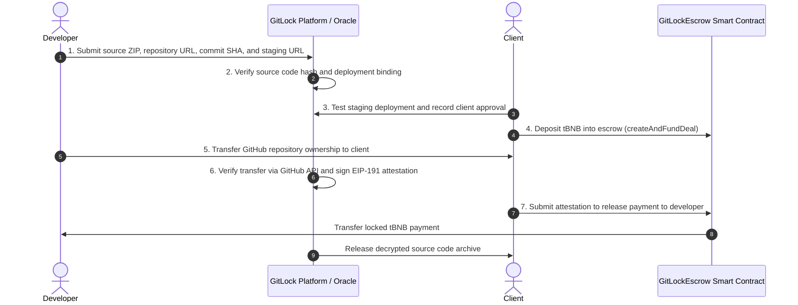

# GitLock: Trustless Code Escrow and Decentralized Delivery Platform

Verifiable, blockchain-based freelance code escrow and deployment binding platform deployed on BNB Smart Chain Testnet (Chain ID 97).

---

## 1. Problem Statement

Freelance software transactions involve counterparty risks for both clients and developers:
- Clients face the risk of receiving unverified, malicious, or non-functional code after paying.
- Developers face payment withholding or chargebacks after delivering intellectual property.

GitLock addresses these challenges by cryptographically verifying source code integrity (SHA-256 hash validation) and live deployment consistency (GitHub Deployments API), then utilizing a non-custodial smart contract escrow on the BNB Smart Chain. The smart contract locks payment until the client approves the live preview and the platform oracle cryptographically certifies that GitHub repository ownership has transferred to the client.

---

## 2. Seven-Step Protocol Workflow



### Detailed Protocol Phases:
1. **Project Submission:** The developer submits the source code archive (ZIP), repository URL, target commit hash, and staging deployment URL.
2. **Code & Deployment Verification:** GitLock verifies source code integrity (ZIP SHA-256 matches GitHub commit archive) and verifies that the staging deployment originated from that specific commit.
3. **Client Approval:** The client reviews the functional staging deployment and submits approval on-chain or via the platform.
4. **Escrow Funding:** The client deposits native tBNB into the `GitLockEscrow` smart contract via MetaMask.
5. **Repository Transfer:** The developer initiates and completes the transfer of the GitHub repository to the client's GitHub organization or account.
6. **Ownership Verification:** The GitLock backend oracle queries the GitHub REST API to confirm that the client is now the repository owner. Upon confirmation, the oracle generates a cryptographically signed EIP-191 attestation containing a unique nonce and expiration deadline.
7. **Payment Release:** The smart contract validates the oracle signature on-chain using `ecrecover`. If valid, the contract releases the locked tBNB directly to the developer's wallet and records the deal as completed. The platform then provides the client with access to decrypt the original source archive.

---

## 3. Smart Contract Architecture

The core contract (`GitLockEscrow`) is written in Solidity `0.8.20` and incorporates the following language concepts:

### Inheritance & Abstract Contracts
- `IGitLockEscrow`: Comprehensive interface defining data schemas, enums, errors, events, and external function signatures.
- `EscrowBase`: Abstract base contract implementing storage layouts, reentrancy guards, modifiers, and access control.
- `AttestationVerifier`: Abstract contract implementing EIP-191 message prefixing, inline assembly signature splitting (`splitSignature`), and `ecrecover` verification.
- `GitLockEscrow`: Concrete implementation inheriting from `EscrowBase` and `AttestationVerifier`.

### Data Structures & State Management
- **Structs:**
  - `Deal`: Contains deal identifier (`bytes32`), client address, developer address, escrow amount (`uint256`), state (`DealState`), repository full name, and lifecycle timestamps.
  - `OwnershipAttestation`: Encapsulates oracle attestation parameters (`dealId`, `developer`, `client`, `repoFullName`, `nonce`, `deadline`).
- **Enums:**
  - `DealState`: `None`, `Created`, `Funded`, `Approved`, `Completed`, `Refunded`.
- **Mappings:**
  - `mapping(bytes32 => Deal) internal deals;`
  - `mapping(bytes32 => bool) public usedNonces;` (Replay attack prevention)
  - `mapping(address => uint256) public totalFundedByClient;`
  - `mapping(address => uint256) public totalEarnedByDeveloper;`

### Security & Error Handling
- **Custom Errors (Gas-Optimized):**
  - `DealNotFound`, `DealAlreadyExists`, `InvalidState`, `InvalidDepositAmount`, `Unauthorized`, `InvalidZeroAddress`, `InvalidEmptyString`, `InvalidOracleSignature`, `AttestationExpired`, `NonceAlreadyUsed`, `TransferFailed`, `ReentrancyGuardReentrantCall`.
- **Modifiers:**
  - `onlyOwner`: Restricts administrative actions to the contract owner.
  - `onlyClient`: Restricts actions to the designated client of a deal.
  - `onlyDeveloper`: Restricts actions to the designated developer of a deal.
  - `inState`: Asserts the deal is in the expected lifecycle state.
  - `validDeal`: Asserts the deal has been initialized.
  - `nonReentrant`: Protects state-changing payable functions against reentrancy attacks using Checks-Effects-Interactions pattern.

### Cryptographic Verification
- Pure function `hashAttestation` computes the Keccak-256 hash of the attestation tuple.
- Pure function `getEthSignedMessageHash` formats the hash according to EIP-191 (`\x19Ethereum Signed Message:\n32`).
- Pure function `recoverSigner` uses inline assembly (`assembly { ... }`) to extract ECDSA `(r, s, v)` components and execute `ecrecover`.

---

## 4. Deployed Smart Contract Specification

- **Network:** BNB Smart Chain Testnet (BSC Testnet)
- **Chain ID:** 97 (`0x61`)
- **Smart Contract Address:** [`0x30CF8a5fa441D39e0604781C24ADeeCBcbfecD49`](https://testnet.bscscan.com/address/0x30CF8a5fa441D39e0604781C24ADeeCBcbfecD49)
- **Oracle Signer Address:** `0x392e227Bf9201A328f9ebD8DBee33f3cBDB15b37`
- **Compiler Version:** Solidity `0.8.20`
- **Optimization:** Enabled (200 runs)
- **Minimal Test Amount:** 0.0001 tBNB (configured to preserve testnet faucet resources)
- **Block Explorer:** [https://testnet.bscscan.com](https://testnet.bscscan.com)

---

## 5. Remix IDE Compilation & Deployment Guide

The contract can be compiled and deployed directly within Remix IDE:

1. **Source File:** Use the consolidated source file located at `contracts/remix/GitLockEscrow_Remix.sol`.
2. **Compiler Settings:**
   - Compiler: `0.8.20`
   - Language: `Solidity`
   - EVM Version: `default`
   - Advanced Configurations: Enable optimization, set runs to `200`.
3. **Deployment Settings:**
   - Environment: `Injected Provider - MetaMask` (Connected to BSC Testnet, Chain ID 97).
   - Contract: Select `GitLockEscrow`.
   - Constructor Parameter (`initialOracle`): `0x392e227Bf9201A328f9ebD8DBee33f3cBDB15b37`.
   - Execute `Deploy` and confirm the transaction in MetaMask.

---

## 6. Testing & Automated Verification

### Foundry Unit & Invariant Test Suite
```bash
cd contracts
forge test -vvv
```
The test suite executes 12 unit and integration tests with zero failures:
- `test_InitialState`: Validates contract ownership and initial oracle registration.
- `test_CreateAndFundDeal`: Validates atomic creation and funding of escrow deals.
- `test_RevertWhen_ZeroDeposit`: Confirms rejection of zero-value funding attempts.
- `test_RevertWhen_SelfDealing`: Confirms rejection when client and developer addresses match.
- `test_ApproveDeployment`: Validates client staging approval transition.
- `test_ReleasePaymentWithValidAttestation`: Validates cryptographic signature verification and native balance payout.
- `test_RevertWhen_InvalidOracleSignature`: Validates rejection of signatures generated by unauthorized keys.
- `test_RevertWhen_AttestationExpired`: Validates rejection of expired attestations.
- `test_RevertWhen_NonceReused`: Validates rejection of replayed nonces.
- `test_Refund`: Validates client refund before completion.
- `test_AdminUpdateOracle`: Validates access control and event emission for oracle updates.
- `test_RemixContract_EndToEnd`: Validates the consolidated Remix single-file contract compilation and execution.

### Live On-Chain Protocol Verification
```bash
# Full 7-Step Escrow Lifecycle (Funding to Payment Release)
node backend/scripts/verifyBlockchainEscrowE2E.js

# On-Chain Refund Lifecycle (Funding to Cancellation and Balance Refund)
node backend/scripts/verifyBlockchainRefundE2E.js
```

---

## 7. Technology Stack

- **Blockchain & Smart Contracts:** Solidity `^0.8.20`, Foundry (`forge`), Remix IDE, BNB Smart Chain Testnet.
- **Backend:** Node.js, Express.js, Ethers.js v6, PostgreSQL (Supabase), Octokit (GitHub REST API), AES-256 / RSA hybrid key exchange.
- **Frontend:** Next.js 16 (App Router), React 19, Tailwind CSS, Lucide React, Ethers.js v6 Web3 integration with MetaMask.
- **Cloud Infrastructure:** Google Cloud Run (Containerized Backend), Vercel (Frontend Hosting).

---

## 8. Environment Variables

### Backend Configuration (`backend/.env`)
```env
PORT=5000
FRONTEND_URL=https://git-lock-delta.vercel.app
DATABASE_URL=postgresql://...
JWT_SECRET=...
ENCRYPTION_KEY=...
BSC_TESTNET_RPC=https://data-seed-prebsc-1-s1.binance.org:8545/
BSC_CHAIN_ID=97
ESCROW_CONTRACT_ADDRESS=0x30CF8a5fa441D39e0604781C24ADeeCBcbfecD49
ORACLE_ADDRESS=0x392e227Bf9201A328f9ebD8DBee33f3cBDB15b37
ORACLE_PRIVATE_KEY=...
MINIMAL_TEST_AMOUNT=0.0001
NODE_ENV=production
```

### Frontend Configuration (`frontend/.env.local`)
```env
NEXT_PUBLIC_API_BASE_URL=https://gitlock-backend-197473198672.asia-southeast1.run.app/api
NEXT_PUBLIC_API_URL=https://gitlock-backend-197473198672.asia-southeast1.run.app/api
NEXT_PUBLIC_FRONTEND_URL=https://git-lock-delta.vercel.app
NEXT_PUBLIC_BSC_CHAIN_ID=97
NEXT_PUBLIC_BSC_RPC=https://data-seed-prebsc-1-s1.binance.org:8545/
NEXT_PUBLIC_ESCROW_CONTRACT_ADDRESS=0x30CF8a5fa441D39e0604781C24ADeeCBcbfecD49
NEXT_PUBLIC_MINIMAL_TEST_AMOUNT=0.0001
```
